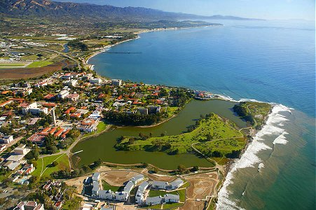

Jean-Pierre Fouque
==================

This library is dedicated to Jean-Pierre Fouque as he approaches retirement. He was in many ways the original
inspiration for it. The timing coincides with the Center for Financial Mathematics and Actuarial Research at UC
Santa Barbara, which he founded in 2006 and has directed since, with Mike Ludkovski, a founding member, as
co-director since 2016, reaching a twenty-year milestone, during which time more than forty PhD statisticians,
quants and applied mathematicians have been educated there.

   Jean-Pierre Fouque. Photo: CFMAR, UC Santa Barbara.

Fouque took his doctorate at Paris 6 in 1979 under Nicole El Karoui, on the regularity of amarts, and his Doctorat
d'État in 1986. As a CNRS researcher in Paris and then at the École Polytechnique he worked on stochastic analysis
and on the hydrodynamic limits of asymmetric interacting particle systems, the exclusion and zero-range processes,
with Albert Benassi and others. In the 1990s his attention turned to waves in random media: the parabolic and
white-noise approximations, the diffusion approximation regime, and time reversal, in which a pulse scattered by a
random medium is recorded, reversed and sent back, and refocuses. That program, much of it joint with George
Papanicolaou and with his own students Josselin Garnier, Jean-François Clouet and Florence Bailly, became *Wave
Propagation and Time Reversal in Randomly Layered Media* (Springer, 2007), with Garnier, Papanicolaou and Knut
Sølna.

The same asymptotic machinery, applied to a fast mean-reverting volatility factor, is the multiscale stochastic
volatility theory he built with Papanicolaou and Ronnie Sircar at North Carolina State and Stanford: *Derivatives
in Financial Markets with Stochastic Volatility* (Cambridge University Press, 2000), extended with Sølna to
multiple time scales and to interest-rate and credit derivatives in *Multiscale Stochastic Volatility for Equity,
Interest-Rate and Credit Derivatives* (Cambridge University Press, 2011). Around the books sit the second-order
expansions and their terminal-layer analysis, multiname default modeling, variance reduction for Monte Carlo under
stochastic volatility, and the portfolio-optimization asymptotics with Sircar and Thaleia Zariphopoulou, later
carried to fractional and rough volatility environments with Ruimeng Hu. He directed the Financial Mathematics
Program at North Carolina State from 2002 to 2005 before moving to Santa Barbara.

After the 2008 crisis his work turned to systemic risk. He co-edited the *Handbook on Systemic Risk* (Cambridge
University Press, 2013) with Joseph Langsam, studied the stability of interbank lending models with Tomoyuki Ichiba,
and with René Carmona and Li-Hsien Sun wrote *Mean Field Games and Systemic Risk* (2015), which made a tractable
mean field game out of banks borrowing from and lending to a central lender. The mean field thread has continued
into deep learning and reinforcement learning methods for mean field games and mean field control, with Andrea
Angiuli, Mathieu Laurière, Hu and others, and into learned systemic risk measures.

He is a Fellow of the Institute of Mathematical Statistics (2009), of the Society for Industrial and Applied
Mathematics (2011) and of the Institut Louis Bachelier (2021). He chaired the SIAM Activity Group on Financial
Mathematics and Engineering, was Editor-in-Chief of the *SIAM Journal on Financial Mathematics* from 2015 to 2020,
served as President of the Bachelier Finance Society from 2018 to 2020, and sat on the Financial Research Advisory
Committee of the US Treasury's Office of Financial Research. He has supervised some thirty doctoral students, in
France, at North Carolina State and at Santa Barbara.

The expansion this library runs uses the broader idea: price by expanding in the time scale of a fast hidden
factor. The finite-state version, with a Markov chain in place of the mean-reverting diffusion, was developed by
Peter Cotton as a student of George Papanicolaou (see :doc:`background`). This particular package does not (yet)
extend to all the stochastic volatility work Fouque did, but perhaps someone in the community might like to take up
that challenge.

The center marked its tenth year with a conference on 19 to 21 May 2017, organized by Fouque and Mike Ludkovski,
with talks from Adrian Banner, René Carmona, Peter Carr, Bruno Dupire, Ronnie Sircar and Thaleia Zariphopoulou among
others. Its work has run from multiscale stochastic volatility to mean field games for systemic risk, stochastic
portfolio theory, Gaussian process regression for portfolio risk, and Monte Carlo methods for stochastic control.

Congratulations to the center, its students and its visitors on twenty years, and to Jean-Pierre on his
retirement.

`cfmar.pstat.ucsb.edu <https://cfmar.pstat.ucsb.edu>`_
